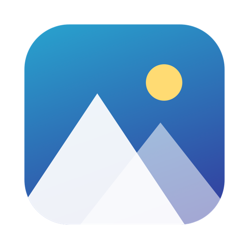

# Mirue

[English](README.md)

トラックパッドで気持ちよく操作できる、Mac 用の画像ビューワです。
画像は枠のない「浮いた 1 枚」として表示され、ピンチや回転に合わせてウィンドウごと大きさが変わります。無料です。

## ダウンロード

1. [最新のリリース](https://github.com/satoo3/Mirue-releases/releases/latest)から `Mirue-<バージョン>-mac.dmg` をダウンロードして開きます。
2. Mirue を「アプリケーション」フォルダへドラッグし、そこから開きます。

- macOS 12 Monterey 以降（Apple シリコン、Intel）
- Developer ID で署名し、Apple の公証を受けています

## 操作

| 操作 | 動き |
| --- | --- |
| 1 本指ドラッグ / 2 本指ドラッグ | ウィンドウを動かす（画面より大きいときは中の画像を動かす） |
| 2 本指ピンチ | 拡大縮小（ウィンドウも追従） |
| 2 本指回転 | 回転（90° 付近で吸着） |
| マウスホイール | 拡大縮小 |
| Shift + ホイール | 5° ずつ回転 |
| ダブルクリック | 回転と拡大をリセット |
| 右クリック（2 本指タップ） | メニュー |
| ← / → | 同じフォルダの前後の画像 |

そのほかの機能:

- タイトルバーを隠すモード
- アルファチャンネルのある画像や回転時の余白は、ウィンドウも透過（透明部分へのクリックは後ろのウィンドウに届きます）
- 開いたときに画面に合わせて最大化するか、画像のサイズを優先するかを選べます
- 画像の既定アプリを、形式を選んでまとめて Mirue に切り替え / 元に戻せます（「Mirue」メニュー）

## 対応形式

PNG、JPEG、GIF、WebP、HEIC、AVIF、TIFF、BMP、ICO、ICNS、JPEG 2000、TGA、PSD、各社 RAW、SVG など、
macOS が読める画像全般。GIF・APNG・WebP のアニメーションも再生します。

## 使用許諾・免責事項・プライバシー

Mirue は無料でダウンロードして使えます。オープンソースではありません: © 2026 Ultrawarp, all rights reserved.

- **使用許諾**: [TERMS.md](TERMS.md) — 使ってよい範囲と、してはいけないこと
- **免責事項**: Mirue は現状のまま無償で提供され、動作などについての保証はありません。使ったこと、使えなかったことによる損害（データの消失を含みます）について、作者は責任を負いません。詳しくは使用許諾の第5条・第6条をご覧ください
- **プライバシーポリシー**: [PRIVACY.md](PRIVACY.md) — 個人情報は集めず、外部とも通信しません

[LICENSE.md](LICENSE.md)（英語）は使用許諾の要約です。

## お問い合わせ

support@ultrawarp.jp

このリポジトリは配布専用で、ソースコードは含みません。
