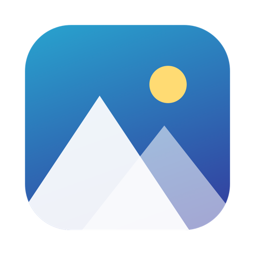

# Mirue

[日本語](README.ja.md)

A trackpad-friendly image viewer for the Mac. Each image floats as a frameless sheet, and the window follows
as you pinch and rotate. Free.

## Download

1. Download `Mirue-<version>-mac.dmg` from the [latest release](https://github.com/satoo3/Mirue-releases/releases/latest) and open it.
2. Drag Mirue to the Applications folder, then open it from there.

- macOS 12 Monterey or later (Apple silicon and Intel)
- Signed with Developer ID and notarized by Apple
- The menus are in Japanese

## Controls

| Gesture | What it does |
| --- | --- |
| Drag with one or two fingers | Move the window (or pan the image when it is larger than the screen) |
| Pinch | Zoom; the window follows |
| Rotate with two fingers | Rotate; snaps near 90° |
| Mouse wheel | Zoom |
| Shift + wheel | Rotate in 5° steps |
| Double-click | Reset rotation and zoom |
| Esc | Close the image |
| Right-click (two-finger tap) | Menu |
| ← / → | Previous / next image in the same folder |

Also:

- A mode that hides the title bar
- Save the open image in another format: PNG, JPEG, HEIC, TIFF, GIF, BMP or JPEG 2000 (File > 別の形式で書き出す…, ⌘⇧S)
- A small puff of smoke when you close an image (can be turned off)
- Images with an alpha channel, and the margins of a rotated image, make the window itself see-through; clicks
  on the transparent parts go to the window behind
- Open images either as large as the screen allows, or at their own size
- Make Mirue the default app for the image formats you choose, in one step, and switch back (the Mirue menu)

## Formats

Anything macOS can read: PNG, JPEG, GIF, WebP, HEIC, AVIF, TIFF, BMP, ICO, ICNS, JPEG 2000, TGA, PSD, camera RAW,
SVG and more. Animated GIF, APNG and WebP play.

## Terms, disclaimer and privacy

Mirue is free to download and use. It is not open source: © 2026 Ultrawarp, all rights reserved.

- **Licence terms**: [TERMS.en.md](TERMS.en.md) — what you may and may not do
- **Disclaimer**: Mirue is provided as it is, free of charge and without warranty of any kind. The author is not
  liable for any damage (including loss of data) caused by using, or being unable to use, it. See sections 5
  and 6 of the licence terms
- **Privacy policy**: [PRIVACY.en.md](PRIVACY.en.md) — no personal information is collected, and the app does not
  use the network

[LICENSE.md](LICENSE.md) summarises the licence terms.

## Contact

support@ultrawarp.jp

This repository is for distribution only and does not contain source code.
